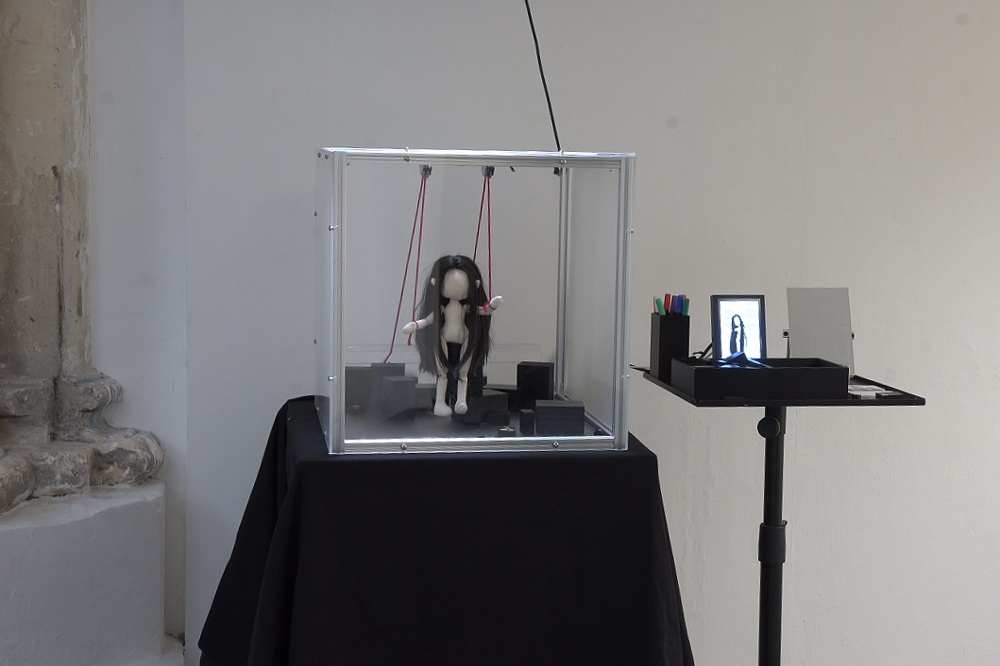

# To Be Viewed

Arduino code for **To Be Viewed**, an interactive installation exploring how external attention and social feedback can reshape self-perception and agency.

## Interaction

Visitors choose a pre-written comment block or emoji token and drop it into the installation. Infrared sensors detect the input and trigger servo motors, which pull red strings connected to the puppet’s arms.

After a random number of inputs, the puppet returns to its initial position.

## Hardware

- Arduino
- 2 infrared sensors
- 2 servo motors
- External power supply
- Fixed pulleys
- 3D-printed comment and emoji tokens

## AI Assistance

ChatGPT was used as a supporting tool to help explain, debug and integrate parts of the Arduino code. The interaction logic, hardware setup, servo angles, testing and final adjustments were developed through physical prototyping.

## Author

Xintong Wu  
MA Computational Arts  
Goldsmiths, University of London
